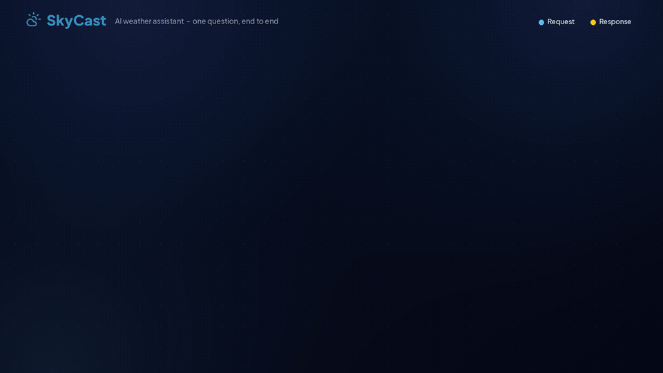

# 🌦️ MCP Weather & AI Assistant — SkyCast AI

A TypeScript project exploring the **Model Context Protocol (MCP)** by connecting weather tools, forecasts, and an AI-powered weather assistant.

SkyCast AI combines weather data from Open-Meteo, Google Gemini integration, and modular MCP tools to demonstrate how AI applications can interact with external services.

## ✨ Features

* 🌤️ **Current Weather** — Retrieve weather information for a city.
* 📅 **Weather Forecasts** — Access forecasts for up to three days.
* 🤖 **AI Weather Assistant** — Ask natural-language weather questions using Google Gemini.
* 🧠 **Weather Intelligence** — Analyze weather information to support weather-related decisions.
* 🔌 **MCP Integration** — Expose tools and capabilities through the Model Context Protocol.
* 🌐 **HTTP API** — Provide HTTP endpoints for weather information and AI functionality.
* ➕ **Calculator Tools** — Include basic mathematical operations through MCP tools.
* ✅ **Input Validation** — Validate inputs and handle errors.
* 🧪 **Automated Testing** — Test application functionality using Vitest.
* 🖥️ **Interactive Web Interface** — Explore weather information and interact with the AI assistant.

## 🛠️ Technology Stack

| Technology                   | Purpose                                            |
| ---------------------------- | -------------------------------------------------- |
| TypeScript                   | Main programming language                          |
| Node.js                      | JavaScript runtime                                 |
| Google Gemini                | AI-powered weather assistance                      |
| Model Context Protocol (MCP) | Communication between compatible clients and tools |
| Open-Meteo                   | Weather and forecast data                          |
| Axios                        | HTTP requests                                      |
| Zod                          | Input validation                                   |
| Vitest                       | Automated testing                                  |
| React                        | Frontend user interface                            |
| Vite                         | Frontend development and build tooling             |
| Git and GitHub               | Version control and source-code hosting            |

## 🏗️ Architecture

SkyCast AI uses a modular architecture that separates the AI assistant, MCP communication, weather tools, weather intelligence, and HTTP API.

### 🎬 Architecture Workflow Animation

The animation below illustrates the high-level architecture and the interaction between the AI assistant, MCP components, weather tools, and external weather data.



### 🔄 High-Level Workflow

```text
                         User
                          |
                          v
                 React Web Interface
                          |
                          v
                      HTTP API
                          |
                          v
                AI Weather Assistant
                          |
                          v
                    Google Gemini
                          |
                          v
                      MCP Client
                          |
                          v
                      MCP Server
                          |
              +-----------+-----------+
              |           |           |
              v           v           v
          Current     Forecast     Weather
          Weather      Tools     Intelligence
              |           |           |
              +-----------+-----------+
                          |
                          v
                    Open-Meteo APIs
                          |
                          v
                     Weather Data
```

> **Note:** This is a high-level conceptual diagram. The actual request path depends on the endpoint used. Some frontend weather features and HTTP API routes may retrieve weather data directly rather than passing through MCP.

### 🧠 AI Weather Processing

The AI assistant uses Google Gemini to interpret weather-related questions and determine when to request information from supported weather tools.

Weather-answer validation checks certain weather-condition claims against successful tool results. It does not independently verify every number or statement.

## 🌤️ Weather Features

### Current Weather

Retrieve supported weather information, such as:

* Temperature
* Feels-like temperature
* Weather conditions
* Humidity
* Precipitation
* Wind speed and direction
* Visibility
* Atmospheric pressure

The exact fields depend on the weather endpoint and the data returned by the API.

### Weather Forecasts

Retrieve forecasts for up to three days, including supported fields such as:

* Minimum temperature
* Maximum temperature
* Average temperature
* Weather conditions
* Probability of rain
* Humidity
* Wind speed

### AI Weather Assistant

Ask natural-language questions about current conditions and forecasts.

Example questions:

* What is the current weather in Kandy?
* What will the weather be like in Colombo tomorrow?
* Is the forecast suitable for outdoor activities?
* What should I consider before planning an outdoor event?

AI-generated responses can contain errors. Check reliable weather sources before making important travel, outdoor, or safety decisions.

## 🚀 Getting Started

Follow these steps to set up the project locally.

### 1. Prerequisites

Install the following software:

* [Node.js](https://nodejs.org/)
* npm
* [Git](https://git-scm.com/)
* [Visual Studio Code](https://code.visualstudio.com/) or another code editor

A Google Gemini API key is required for the AI assistant.

### 2. Clone the Repository

```bash
git clone https://github.com/VishwaChandeepa/mcp-weather-calculator.git

cd mcp-weather-calculator
```

### 3. Install Dependencies

From the project root, run:

```bash
npm install
```

If the `web` directory contains its own `package.json`, install the frontend dependencies separately:

```bash
cd web
npm install
cd ..
```

### 4. Configure Environment Variables

Create a `.env` file in the project root if required by your application.

Example configuration:

```env
GEMINI_API_KEY=your_gemini_api_key
MCP_URL=http://localhost:3000/mcp
PORT=3000
FRONTEND_URL=http://localhost:5173
GEMINI_MODEL=your_supported_gemini_model
WEATHER_REQUEST_TIMEOUT=10000
```

Replace the placeholder values with the configuration required by your application.

**Security reminders:**

* Use a valid Gemini API key.
* Confirm that your selected Gemini model is supported.
* Verify the MCP URL and other settings against your source code.
* Never commit your actual `.env` file or publish API keys.

### 5. Build the Project

```bash
npm run build
```

### 6. Run Automated Tests

```bash
npm test
```

Run these commands locally to verify the current version of the application.

## ▶️ Running the Application

The project may contain an MCP server, an HTTP API, and a web frontend. Start each component using the scripts configured in your `package.json` files.

### Start the MCP Server

```bash
npm start
```

This command is intended to start the stdio-based MCP server if configured that way in `package.json`.

### Start the HTTP Server

If the project defines a `start:http` script, run:

```bash
npm run start:http
```

The HTTP server uses port `3000` by default if configured accordingly.

To list the available npm scripts, run:

```bash
npm run
```

### Start the Frontend

If the `web` directory contains a Vite application with a `dev` script:

```bash
cd web
npm run dev
```

Vite commonly serves the development application at:

```text
http://localhost:5173
```

Use the actual address printed in your terminal if it differs.

### Available HTTP Endpoints

The following endpoints are documented by the project. Confirm their availability against your current implementation.

| Endpoint            | Purpose                     |
| ------------------- | --------------------------- |
| `/mcp`              | MCP communication over HTTP |
| `/api/weather`      | Current weather API         |
| `/api/forecast`     | Weather forecast API        |
| `/api/intelligence` | Weather intelligence API    |
| `/api/ai`           | AI assistant API            |

Example local addresses:

```text
http://localhost:3000/api/weather
http://localhost:3000/api/forecast
http://localhost:3000/api/intelligence
http://localhost:3000/api/ai
```

These are local development addresses, not public deployment URLs.

## 🧪 Development Commands

| Command              | Purpose                             |
| -------------------- | ----------------------------------- |
| `npm install`        | Install dependencies                |
| `npm start`          | Start the configured MCP server     |
| `npm run start:http` | Start the HTTP server if configured |
| `npm test`           | Run automated tests                 |
| `npm run build`      | Build the project                   |
| `npm run`            | List available npm scripts          |

Use the scripts in your current `package.json` as the authoritative reference.

## 📁 Project Structure

The following is an illustrative overview of the project. Adjust it to match your actual repository.

```text
mcp-weather-calculator/
├── assets/
│   └── skycast-mcp-flow.gif
├── src/
│   ├── ai/
│   │   ├── weatherAssistant.ts
│   │   └── weatherAssistant.test.ts
│   ├── api/
│   │   ├── ai.ts
│   │   ├── forecast.ts
│   │   ├── intelligence.ts
│   │   └── weather.ts
│   ├── intelligence/
│   │   └── weatherIntelligence.ts
│   ├── prompt/
│   │   └── weatherReport.ts
│   ├── resources/
│   │   └── serverInfo.ts
│   ├── tools/
│   │   ├── calculator.ts
│   │   ├── forecast.ts
│   │   ├── intelligence.ts
│   │   ├── server.ts
│   │   └── weather.ts
│   ├── config.ts
│   ├── http.ts
│   └── index.ts
├── web/
│   ├── src/
│   ├── package.json
│   └── vite.config.ts
├── .env.example
├── .gitignore
├── package.json
├── package-lock.json
└── README.md
```

*This structure is illustrative. Keep the README aligned with the files that actually exist in your repository.*

## 🔐 Security and Reliability

The project demonstrates practices such as:

* Environment-based configuration for application settings and API credentials.
* Input validation for incoming requests.
* Error handling for external API requests.
* MCP tool integration for supported functionality.
* Automated tests for selected application behavior.
* Weather-answer validation to help reduce unsupported weather-condition claims.

### Environment File Safety

Do not upload your actual `.env` file to GitHub.

You can provide a `.env.example` file containing placeholders:

```env
GEMINI_API_KEY=
MCP_URL=http://localhost:3000/mcp
PORT=3000
FRONTEND_URL=http://localhost:5173
GEMINI_MODEL=
WEATHER_REQUEST_TIMEOUT=10000
```

Include only variables used by your application.

Make sure `.env` is listed in `.gitignore` before committing changes.

## 🛣️ Future Improvements

Potential improvements include:

* Improve AI response validation, including numeric values and unsupported claims.
* Expand automated tests and edge-case coverage.
* Add GitHub Actions for continuous integration.
* Improve the dashboard's responsive design and accessibility.
* Improve error messages and API request handling.
* Add Docker support.
* Deploy the application online.
* Add additional weather tools through MCP.
* Improve technical documentation and architecture diagrams.

## 👨‍💻 Author

**Vishwa Chandeepa Senarathna**

Software Engineering Undergraduate
NSBM Green University

* **GitHub:** [VishwaChandeepa](https://github.com/VishwaChandeepa)
* **LinkedIn:** [vishwachandeepa](https://www.linkedin.com/in/vishwachandeepa/)

## ⭐ Feedback

If you find this project interesting, feel free to explore the repository, share feedback, and suggest improvements.

---

*Built as a learning project to explore TypeScript, AI integration, weather APIs, and the Model Context Protocol (MCP).*
